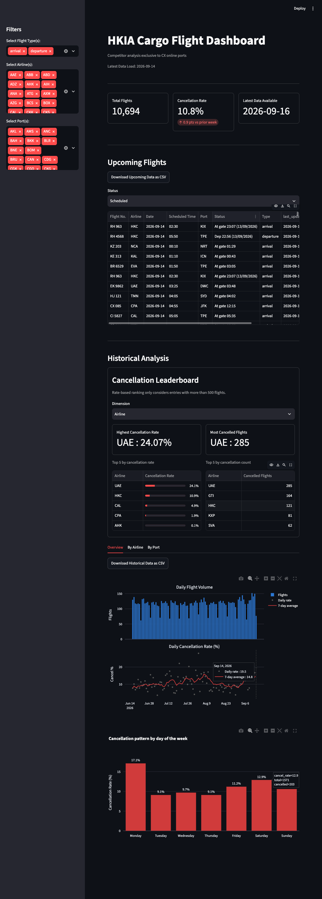

# ✈️ HKIA Cargo Flight Dashboard

*(ongoing: bug fixing in the filtering)*

A dashboard that tracks **cargo flights at Hong Kong International Airport (HKIA)**, showing how many flights operate, which ones get cancelled, and how this changes over time.

It focuses on the routes that **Cathay Pacific (CX)** also serves, so you can see how other cargo airlines are performing on the same routes.

👉 **[Open the live dashboard](https://your-app.streamlit.app)**👈

## 📸 Dashboard preview

--- 

## What you can see

- **Key numbers at a glance**: total flights, the overall cancellation rate, and how it compares with the previous week.
- **Upcoming flights**: cargo flights scheduled over the next few days, with their latest status.
- **Cancellation leaderboard**: the airlines and destinations with the highest cancellation rates and counts.
- **Trends over time**: daily flight volumes, daily cancellation rates, and which days of the week see the most cancellations.
- **Breakdowns by airline and by port**: how many flights each airline or destination had, and how many were cancelled.

## How to use it

- Use the **filters on the left** to narrow everything down by flight type (arrival or departure), airline, or port. All the charts update to match.
- Hover over a chart to see exact figures.
- Use the **download buttons** to save the flight data shown as a spreadsheet (CSV).

## Where the data comes from

- Flight information comes from HKIA's public flight information service, the same data shown on the airport's website.
- The data is **refreshed automatically once a day**. Each update covers yesterday's final flight results and the schedule for the next few days.
- Records go back to **16 June 2026**, and the history grows every day.

## Good to know

- Only **cargo** flights are included, not passenger flights.
- Only **ports that Cathay Pacific serves** are included.
- A flight counts as **cancelled** if the airport listed its status as "Cancelled". Delays are not counted as cancellations.
- Statuses for upcoming flights can still change until the flight operates.
- ‼️[_v1 or prototype of this project is here](https://github.com/Fiona1926/HKIA-flight-dashboard)‼️